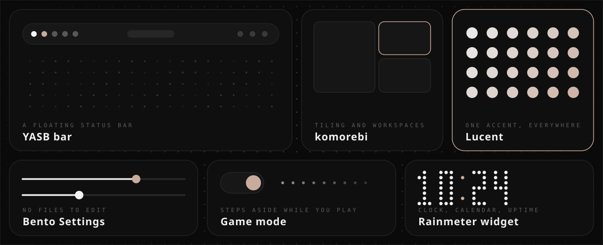
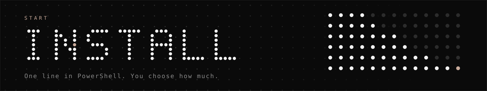
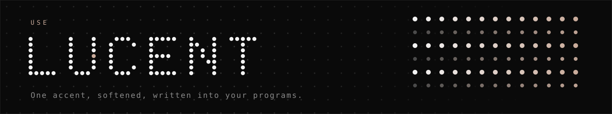
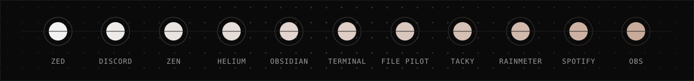

<p align="center">
  
</p>

<p align="center">
  <a href="https://programmermansudjo.github.io/bento"><b>Docs</b></a> &nbsp;/&nbsp;
  <a href="https://programmermansudjo.github.io/bento/lucent.html"><b>Lucent: supported programs</b></a> &nbsp;/&nbsp;
  <a href="https://github.com/ProgrammerManSudjo/bento/releases/latest"><b>Releases</b></a>
</p>

<br>

Bento turns a fresh Windows 11 PC into a quiet, monochrome desktop: a floating [YASB](https://github.com/amnweb/yasb) bar, [komorebi](https://github.com/LGUG2Z/komorebi) tiling,
and **Lucent**, a one-switch accent colour that follows your wallpaper into the programs you use. One installer, a settings app, no config files to edit by hand.

<p align="center"></p>



In a normal (not administrator) PowerShell:

```powershell
irm https://raw.githubusercontent.com/ProgrammerManSudjo/bento/main/install.ps1 | iex
```

It asks whether you want the whole suite or to pick the pieces, installs [Scoop](https://scoop.sh) if you don't have it, and walks you through the one thing it can't do for you
(Windhawk, a manual download). Nothing is written without a backup: anything it would overwrite is kept next to it as `*.backup-<time>`. Add `-DryRun` to see what it would do first.

<details>
<summary>Prefer to read it first, or run it from a clone?</summary>

```powershell
git clone https://github.com/ProgrammerManSudjo/bento
cd bento
.\install.ps1 -DryRun     # shows every step and changes nothing
.\install.ps1             # the menus
.\install.ps1 -Preset Full -Yes   # no questions: the whole suite (Windhawk is skipped)
```
</details>

## What is in it

| | |
| --- | --- |
| **YASB bar** | A floating bar with workspaces, the active layout, clock, tray and a home menu. |
| **komorebi + whkd** | Tiling, workspaces and keyboard shortcuts, plus Alt / Win + scroll to move around. |
| **Bento Settings** | A small app for the bar, widgets, komorebi, borders, wallpaper and Lucent. Changes wait for Apply. |
| **Lucent** | One accent colour, softened, written into your programs. A monochrome fallback when it is off. |
| **Game mode** | Switches the hotkeys, bar and tiling off while a game runs, and back on after. |
| **Rainmeter widget** | A clock, calendar, seconds and uptime tiles, in the same style. |
| **Extras** | Tacky Borders, AltSnap, fastfetch, Spicetify, Windhawk, six original wallpapers. |





### Supported programs

Switch Lucent on, pick an accent (or let it follow Windows), press **Apply now**. These are updated, and each has its own accent or monochrome tone.

| Program | What changes | Get it |
| --- | --- | --- |
| Zed | A theme, "YASB Accent" | [zed.dev](https://zed.dev/download) |
| Discord | A BetterDiscord / Vencord / Equicord theme | [BetterDiscord](https://betterdiscord.app) / [Vencord](https://vencord.dev) / [Equicord](https://equicord.org) |
| Zen Browser | Browser and page colours | [zen-browser.app](https://zen-browser.app) |
| Helium | An unpacked theme extension | [github.com/imputnet/helium](https://github.com/imputnet/helium) |
| Obsidian | A CSS snippet for every vault | [obsidian.md](https://obsidian.md) |
| Windows Terminal | A colour scheme, "YASB Accent" | [github.com/microsoft/terminal](https://github.com/microsoft/terminal) |
| File Pilot | A colour scheme | [filepilot.tech](https://filepilot.tech) |
| Tacky Borders | Window border colours | [github.com/lukeyou05/tacky-borders](https://github.com/lukeyou05/tacky-borders) |
| Rainmeter | The Bento widget's highlights | [rainmeter.net](https://www.rainmeter.net) |
| Spotify | A colour scheme in the Comfy theme | [Spicetify](https://spicetify.app) + [Comfy](https://github.com/Comfy-Themes/Spicetify) |
| OBS Studio | A variant of the Yami theme | [obsproject.com](https://obsproject.com) |
| YASB bar, taskbar | Capsule colours, via the bar styles and [Windhawk](https://windhawk.net) | built in |

More detail and per-program notes: the [docs](https://programmermansudjo.github.io/bento/lucent.html).


Bento is a layer of configuration and a small settings app on top of other people's work. It would not exist without them, and they deserve your support:

- [**komorebi**](https://github.com/LGUG2Z/komorebi) and [whkd](https://github.com/LGUG2Z/whkd) by LGUG2Z, an exceptional tiling window manager for Windows.
- [**YASB**](https://github.com/amnweb/yasb) by AmN, the status bar everything here is built around.
- [Windhawk](https://windhawk.net), [Tacky Borders](https://github.com/lukeyou05/tacky-borders), [Rainmeter](https://www.rainmeter.net), [AltSnap](https://github.com/RamonUnch/AltSnap),
  [Spicetify](https://spicetify.app), [Comfy](https://github.com/Comfy-Themes/Spicetify), [Scoop](https://scoop.sh), [fastfetch](https://github.com/fastfetch-cli/fastfetch).

Star them, sponsor them, read their licences. **They have their own licences, and Bento does not change them**: komorebi in particular is not under a standard open-source licence,
so check its terms before using it commercially.


### Licence

Bento itself (the installer, the settings app, the configuration, the Rainmeter skin and the wallpapers) is released under the [MIT licence](LICENSE): use it, change it, share it.
The fonts in the Rainmeter skin and the settings app (Geist, Geist Mono Nerd Font) keep their own open licences (SIL OFL).

Built by its author with AI assistance (Claude Code) and run on a real machine. As with any installer: read the scripts before you run them.
